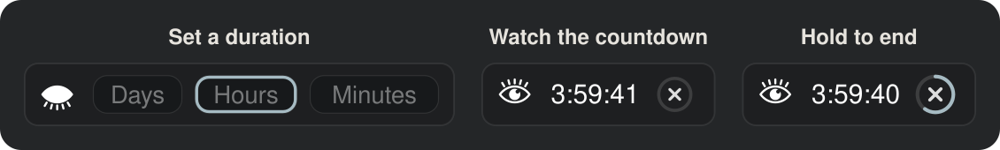
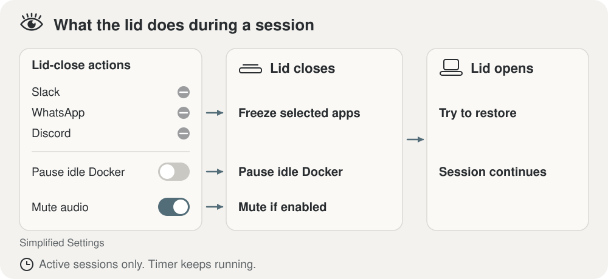
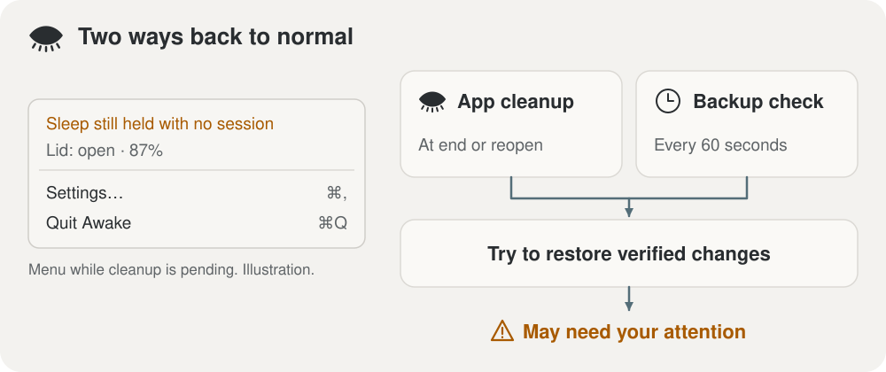

# Awake

**Run your coding agents overnight. Watch and steer them from your phone.**

Awake is a macOS menu bar app for people who run AI coding agents (Claude Code, Codex, Cursor, Devin, local models) and want to walk away from the laptop. It keeps a MacBook awake for a set time, lid closed if you like, keeps the agents running at full speed, and tells your phone when something needs you: a dying battery, a laptop getting hot, Wi-Fi that looks connected but isn't, a session about to end. Every change it makes to the Mac is written to disk first, so it can be undone after a crash, and a session always has an end time.

> Recovery can fail, and a running timer is not a safety guarantee: use a stable, well-ventilated surface, not a closed bag. [What can fail and how recovery works](#what-can-fail-and-how-recovery-works) says what Awake does about it and what it cannot do.

<p align="center">
  
</p>

Screenshots of the menu, the Setup window and Settings go in
[docs/assets/screenshots/](docs/assets/screenshots/) (see the README there for
the list and how to take them); a short screen recording of a session will
join them.

## Why

Today the best tool for this, [Insomnia](https://github.com/krishhgg/Insomnia), is very good at one thing: keeping the Mac awake and then putting everything back exactly as it was. It is weak at what someone who has walked away actually needs:

1. **You can't see or control it from away.** Every alert is a macOS notification on a laptop whose lid is closed.
2. **It doesn't know about your agents.** The session runs on a timer, not on the work. It can't tell "all six agents finished at 2am" from "agent three is stuck on a permission prompt".
3. **Some safety checks miss real cases.** A charger too weak for the load counts as "charging", so the battery can drain to 0% mid-session. Lid closed with an external monitor still freezes your apps. Nothing locks the screen.

Awake starts from those gaps.

## What Awake does

The first list is the goal; the items marked *(today)* work now, the rest are planned.

**On the Mac**
- Keeps the Mac awake for a fixed time, never forever, with a recovery journal so everything is undone even after a crash. *(today)*
- On lid close: darkens the screen, mutes audio, freezes chat apps, turns on Low Power Mode, and undoes all of it on lid open. Battery and heat floors end the session before the Mac gets into trouble. *(today)*
- Knows each agent (Claude Code, Codex, Cursor, Aider, Devin, Gemini, Ollama, LM Studio, any tmux pane you mark): alive, busy, idle, stalled, waiting for input, or exited, one line each in the menu. *(today)* See [docs/agents.md](docs/agents.md).
- Detects pop-ups and prompts that block agents (Gatekeeper, permission dialogs, the keychain, "proceed? (y/n)" in a tmux pane) and reports their text and buttons. *(today; dialogs need the Accessibility permission)*
- Opt-in: before a battery, heat or planned end, commits and pushes work in progress in each agent repo; under battery, heat or memory pressure, pauses the lowest-priority agents first. *(today, both off by default)*
- Watches the battery trend (a charger too weak for the load counts as no charger), battery temperature where the Mac reports one, CPU throttling, memory pressure, free disk, and real internet reachability (not just "Wi-Fi connected"). *(today)*
- Locks the screen on lid close. Leaves you alone when an external monitor is attached. *(today)*
- Lets agents ask for awake time themselves: a **lease** per task, released when done. The Mac stays awake while any lease is held, capped by a limit you set. *(today)* From a shell with `awake lease --for 2h --reason "refactor billing"`, or as MCP tools with `awake mcp`; see [docs/leases.md](docs/leases.md).

**On the phone**
- Push alerts for the things that matter: battery or heat, weak charger, internet down and back, session ending in 10 minutes, session ended, something not restored, disk or memory trouble; via ntfy or Pushover, tokens in your keychain. *(today)* Agent waiting, stalled and exited, "All agents finished" and "Dialog blocking" too. *(today)*
- One screen per agent, one tap to answer a prompt, nudge, pause, or stop it.
- A web app served by the Mac over Tailscale to paired phones: time left, extend, end or start a session, lock the screen, take a screenshot, read the machine and the log, Panic. *(today; [docs/phone.md](docs/phone.md))* Agent cards fill in with the agent layer; commit and push a repo is still to come.
- A summary when the session ends: how long it ran, why it ended, battery used, lid closes, Low Power Mode and heat events, outages, whether everything was restored. *(today)* It also lists the agents that ran, finished, stalled or were waiting at the end, and repos with unpushed commits. *(today)*
- `status.json` and a local `http://127.0.0.1:<port>/status.json` for Raycast or SketchyBar, with an `agents` array. *(today)*

## Principles

- **Journal first.** Every change to the machine is written to disk before it is made, and undone from disk, never from memory.
- **Prove ownership.** Never pause or resume a process unless we can prove it is the one we touched (start time to the microsecond, boot session).
- **"Unknown" is a real state.** A reading we can't take is not "fine" and not "broken"; it is unknown, and we say so.
- **Fail closed.** When unsure, do nothing irreversible and tell the user.
- **Say what was checked.** Measured facts, assumptions and guesses are labelled as such.

## Non-goals (for now)

- Not a replacement for running agents on a desktop or a cloud box. For heavy loads that is still the safer answer, and Awake should say so.
- No remote unlock of the Mac. Apple does not allow it, and we would not want it.
- No kernel extension, no background daemon that outlives the session.

## Install

Requires macOS 26 or later on an Apple Silicon Mac. Pick one; all three
install the same release from
[GitHub Releases](https://github.com/ParthJairam07/awake/releases).

**Homebrew**

```bash
brew tap ParthJairam07/awake
brew install --cask awake
```

**Download**

Download `Awake-<version>.dmg` from the
[latest release](https://github.com/ParthJairam07/awake/releases/latest),
open it and drag Awake to Applications. The release notes say whether the
build is signed and notarized by Apple or an **unsigned build: right-click
→ Open on first launch**.

**Terminal**

```bash
curl -fsSL https://raw.githubusercontent.com/ParthJairam07/awake/main/scripts/install.sh | bash
```

This downloads the latest release, checks it against the release's
`SHA256SUMS`, shows what it will install and asks before it changes
anything. It asks for your password once, in the terminal, for the sudoers
rule described below; nothing runs `sudo` without telling you.

The first time Awake opens, a Setup window walks through what it needs:
notifications, the sudoers rule, Accessibility and Screen Recording, phone
alerts and Tailscale. Every step can be skipped, and "Setup…" in the
right-click menu brings it back. With Homebrew or the disk image, Setup is
where the sudoers rule gets installed: until it is, no session can start.

There is no Awake release yet. Until the first one, build from source (below).

**With a coding agent**

Paste this into your coding agent:

```text
Install the latest stable Awake release by following https://github.com/ParthJairam07/awake/blob/main/skills/install-awake/SKILL.md. If a step needs my password, give me the command to run in Terminal.
```

For the newest nightly, write "the newest Awake nightly prerelease" in
place of "the latest stable Awake release". Nightlies are built from `main`
on each day it has new commits. They have the newest code and may be broken.

To install a release by hand, follow [docs/install.md](docs/install.md). It
covers both channels, how to check the download, and `v0.1.0`, which installs
differently.

**Updates.** A build signed with Awake's Developer ID updates itself:
"Check for Updates…" in the right-click menu checks now, and Settings > App
> "Check for updates automatically" (on by default) checks in the
background and asks before installing. An unsigned build never updates
itself; the same menu item opens the releases page instead, and Homebrew
users run `brew upgrade --cask awake`. Settings > App shows the installed
version.

### Build from source

Needs Xcode with Swift 6.2 or later. Replace `v<version>` with the latest
stable tag, or a nightly tag for the newest code:

```bash
git clone --branch v<version> --depth 1 https://github.com/ParthJairam07/awake.git
cd awake
./scripts/install.sh
open "$HOME/Applications/Awake.app"
```

<details>
<summary><strong>What the installer changes on your Mac</strong></summary>

The installer needs your password, because the sudoers rule is a system
file. It installs:

- The app, at `~/Applications/Awake.app`.
- A **recovery agent**, a `launchd` job that runs every minute. If the app is
  gone when a session should have ended, the agent tries to undo the
  session's changes.
- A **sudoers rule** at `/etc/sudoers.d/awake`. A sudoers rule decides who
  can run what with `sudo`. This one lets your user account, not just
  Awake, run these four commands without a password:

```text
/usr/bin/pmset -a disablesleep 1
/usr/bin/pmset -a disablesleep 0
/usr/bin/pmset -b lowpowermode 1
/usr/bin/pmset -b lowpowermode 0
```

Any program running as you can use that rule too, so review it before you
install. [docs/install.md](docs/install.md#what-gets-installed) lists every
file and explains how upgrades replace them.

</details>

## Using it

1. **Start.** Click the eye in the menu bar, enter days, hours and minutes,
   and press Enter.
2. **Add time.** Click the eye or the countdown during a session.
3. **End early.** Press and hold the end control next to the countdown.
4. **Settings and status.** Right-click the eye. Quit asks Awake to undo
   the session first, and it refuses while a change is still waiting to be
   undone. Saved audio for an output that isn't connected doesn't hold it up.
   Awake restores that output if it reconnects while the app runs, or at
   the next launch.

You don't have to close the lid, and opening it doesn't end the session.

On battery power, Awake turns on Low Power Mode below 40% and ends the
session below 10%. Those are the defaults. You can change both in Settings,
and an end floor of 0 turns the battery end off. The heat rules turn on Low Power
Mode when the Mac gets seriously hot and end the session at critical heat.
They are on by default, and Settings can turn them off. All of these rules
only work while the app runs.

Before your first session, check Settings. Then run a short session you can
watch, and read `~/Library/Logs/Awake/awake.log` afterward.

## How it keeps the Mac awake

A session runs `sudo pmset -a disablesleep 1`, the one switch that keeps a
Mac awake with the lid closed and no display attached, and
`sudo pmset -a disablesleep 0` when it ends. That is all "awake" means; there
is no kernel extension and no daemon that outlives the session. The sudoers
rule from Install is what lets Awake run those commands (and the two Low
Power Mode ones) without asking for your password each time.

Because sleep is off for the whole Mac, Awake also does the things sleep
would have done: it locks the screen and turns the display off when the lid
closes, and it watches the battery and the temperature and ends the session
before the Mac gets into trouble.

### What happens when the lid closes

<p align="center">
  
</p>

During a session, closing the lid does each of these, and opening it tries
to undo them. The timer keeps counting down while the lid is closed.

- **The screen locks.** With sleep turned off the Mac never reaches the lock
  macOS applies on wake, so Awake locks it itself, first, before anything
  else. If the lock fails you are told once per session.
- **Display and keyboard light go off.** Awake saves their brightness
  first. With sleep turned off, macOS no longer does this by itself.
- **Apps on the freeze list are frozen.** Freezing sends an app's processes
  `SIGSTOP`, which pauses them until `SIGCONT` on lid open. The list starts
  with Slack, WhatsApp and Discord. "Freeze every other app" is off by
  default. Even when on, it skips meeting, recording and dictation apps: Zoom,
  Teams, Webex, FaceTime, Wispr Flow, Granola, Otter, OBS and Loom.
- **Audio is muted.** Lid open unmutes each output Awake muted, even if you
  switched to another one.
- **Low Power Mode turns on.** It turns off when the lid opens, unless a
  battery or heat rule still needs it.
- **Docker Desktop is frozen when no container runs.** This one is off by
  default.

**With an external display connected, none of this happens.** A lid closed
on a desk is not a departure: Awake leaves the screen, audio, apps and Low
Power Mode alone and the menu reads "Lid: closed, external display". If the
display is unplugged while the lid stays closed, the actions run then.

On Mac laptops with Apple silicon or a T2 chip, closing the lid disconnects
the built-in microphone in hardware. Recording a meeting with the lid closed
needs AirPods or an external mic.

[docs/lid-close.md](docs/lid-close.md) has the details: how Docker is checked,
how brightness is restored, the one-time settings change when you upgrade,
and how to test lid actions without closing the lid.

## What can fail and how recovery works

<p align="center">
  
</p>

Awake writes each change to a **recovery journal**, a file on disk, before
it makes the change. Ending the session tries to undo what the journal lists.
If the app crashes or quits, the recovery agent tries the same once the
session's end time has passed.

Some things need you:

- The recovery agent can't restore audio. Open Awake again for that.
- The recovery agent doesn't watch the battery or the temperature.
- Awake only unfreezes a process it can prove it froze. A frozen process
  it can't prove stays frozen until you check it.

What can go wrong, plainly:

- **The app dies mid-session** (crash, force quit, restart). Sleep stays off
  until the recovery agent, which runs every minute, turns it back on once
  the session's end time has passed. Until then the Mac stays awake, as the
  session asked.
- **The recovery agent cannot run** (the sudoers rule was removed, the agent
  was unloaded). Then nothing turns sleep back on. One command does:
  `sudo pmset -a disablesleep 0`.
- **The Mac overheats or the battery runs out.** The battery and heat rules
  only work while the app runs. In a closed bag the Mac can get hot faster
  than any rule reacts.

If the menu shows a recovery warning, deal with it before you leave the Mac
alone. [docs/recovery.md](docs/recovery.md) explains each case, and
[docs/faq.md](docs/faq.md) answers the common questions.

## Phone alerts

Every notification Awake posts on the Mac can also go to your phone: battery
or heat, a charger too weak for the load, internet down and back, session
ending in 10 minutes, session ended, something not restored. Install the
[ntfy](https://ntfy.sh) app on the phone, subscribe to a topic with a long
random name, and type the same topic in Setup or in Settings > Phone alerts;
"Send test" checks it. Pushover works too. Tokens are kept in the login
keychain, never in `config.json`. A summary is sent when a session ends.

## Privacy

There are no servers of ours. Awake sends nothing anywhere unless you
configure it to: phone alerts go to ntfy or Pushover only if you set a topic
or turn Pushover on, and then only the notification text. Update checks
fetch one file from this repository's GitHub releases. There is no
telemetry, no account and no analytics. Settings and logs stay on the Mac
(see Configuration and privacy under Optional extras).

## Agents

Settings > Agents (details, hook configs and how each state is decided: [docs/agents.md](docs/agents.md)):

- **Track AI coding agents during a session** (on): finds agents by process and marked tmux panes (`tmux set-option -p @awake 1`) every 20 seconds, and takes hook events.
- **Show agents in the menu** (on): one line per agent in the menu bar menu, such as `● claude  busy  3m  repo-name`.
- **Alert when an agent waits for input / stalls / exits** (each on): one notification per change, also sent to the phone.
- **Stalled after** (10 min): silence after which a working agent counts as stalled.
- **Alert when all agents have finished** (on) and **All finished after** (5 min): one notice once every command-line agent has been idle or gone that long.
- **Install hook script**: writes `~/Library/Application Support/Awake/awake-hook.sh`, which Claude Code hooks and Codex `notify` call to say "waiting" or "finished" themselves.
- **Alert on dialogs and permission prompts that block an app** (on) with **Allow Accessibility…**: reads sheets, dialogs and system prompts through the Accessibility API once you allow Awake under Privacy & Security > Accessibility; nothing is read before that, and nothing is ever clicked.
- **Before a battery, heat or planned end, post "Session ending"** (off) and **Also commit and push work in progress in each agent repo** (off): `git add -A`, commit and push per repo, 60 s each, never forced.
- **Pause low-priority agents under battery, heat or memory pressure** (off), with a Low / Normal / High priority per agent kind: lowest first, never the highest priority running, resumed when the pressure clears.

## Optional extras

<details>
<summary><strong>iPhone hotspot handoff and tmux</strong></summary>

If the Wi-Fi drops during a session, Awake can join your iPhone's hotspot.
Set System Settings > Wi-Fi > Ask to join hotspots to Automatically, then enter
the hotspot's name and password in Awake's Settings. The password stays in
your login Keychain. Awake asks for Location Services access, because
macOS requires it to read Wi-Fi network names. It never reads your location.
After you reinstall Awake, enter the password again.

After 90 seconds without a network, Awake can also type `continue` into a
tmux pane running a coding agent. It only types into panes you list in
Settings and mark yourself:

```bash
tmux set-option -p -t <session:window.pane> @awake-nudge on
```

It doesn't press Enter unless you turn that on. Mark a pane you don't type in.
[docs/extras.md](docs/extras.md) has the details.

</details>

<details>
<summary><strong>Chrome, Chromium, Arc and Comet throttling</strong></summary>

These browsers slow down windows that macOS reports as hidden, which includes
every window while the lid is closed. If a running browser lacks
`--disable-backgrounding-occluded-windows` or
`--disable-renderer-backgrounding`, the right-click menu offers "Relaunch
[browser] unthrottled". It asks first, because relaunching quits the browser,
and tabs come back only if the browser reopens them on startup. Some web apps
may still stop with the lid closed.
[docs/extras.md](docs/extras.md#chrome-chromium-arc-and-comet-throttling) has the
details.

</details>

<details>
<summary><strong>Phone app</strong></summary>

A web app for your phone, served by the Mac over
[Tailscale](https://tailscale.com) to phones you have paired: the session
(time left, extend, end, start), the machine's readings, lock, a
screenshot, the log and a Panic button. It listens only on the Mac's
Tailscale address and on `127.0.0.1`, never on the Wi-Fi network. Settings
> **Phone app**:

- **Phone app** (`phoneApp`, off by default): start the server with Awake.
- **Port** (`phonePort`, default 7788): the port it listens on. For an
  https address run `tailscale serve --bg 7788` once in Terminal.
- **Pair phone…** shows a six-digit code and a QR code, good for five
  minutes. Paired phones are listed with **Forget**, and **Forget all
  phones** ends every phone's access.
- **Screen Recording** shows whether macOS lets Awake take the screenshot
  the phone asks for, and opens the Privacy pane.
- **Audit log**: every action a phone takes is written to
  `~/Library/Application Support/Awake/audit.log`.

The Mac cannot be unlocked from the phone.
[docs/phone.md](docs/phone.md) has the setup steps and the security model.

</details>

<details>
<summary><strong>Configuration and privacy</strong></summary>

Settings live in `~/Library/Application Support/Awake/config.json` and logs
in `~/Library/Logs/Awake/`. Awake sets both folders and their files to
owner-only permissions. It leaves symlinks and access control lists (ACLs,
extra per-account permission entries) as they are, so another account can
still have access through one. Logs can contain Wi-Fi names, process details
and tmux targets, so check them before you share one.
[docs/extras.md](docs/extras.md#configuration-and-privacy) has the details.

</details>

<details>
<summary><strong>Leases: agents ask for awake time</strong></summary>

```bash
awake lease --for 2h --reason "refactor billing"   # prints a lease id
awake lease --until-exit -- make test              # held while the command runs
awake leases
awake release <id>
```

Awake runs a session while any lease is held and ends it 5 minutes after the
last one is released or expires. A session you started is never cut short.
The battery and heat rules still end a session whatever leases say, and
ending a session by hand revokes its leases. `awake mcp` offers the same to
Claude Code, Codex and Cursor as MCP tools.

Settings > Leases has: **Honour leases** (on), **A lease may start a
session** (on), **Leases hold the Mac for at most** (8 h), **End after the
last lease** (5 min later), **Notify when a lease is granted and when the
last one is released** (on), and **Install `awake` command**, which links
the command inside the app into `/usr/local/bin` or `~/.local/bin`
(`scripts/link-cli.sh` does the same). [docs/leases.md](docs/leases.md) has
the agent configs and every rule.

</details>

## Uninstall

With Homebrew: `brew uninstall --cask awake` (add `--zap` to remove the
sudoers rule, settings and logs too). End a running session first.

From your checkout:

```bash
./scripts/uninstall.sh          # removes the app, the agent and the sudoers rule
./scripts/uninstall.sh --purge  # also removes settings and logs
```

Without a checkout, download `uninstall.sh` from the release's page and run
`bash uninstall.sh` instead. The
uninstaller undoes any open session first and stops if it can't.
[docs/install.md](docs/install.md#uninstall) has the details.

## Development

```bash
swift build
swift test
```

The tests use fakes and temporary folders, so they never change your power
settings. See [Contributing](CONTRIBUTING.md), [Security reporting](SECURITY.md),
[Release validation](docs/release-validation.md), [Releasing](docs/releasing.md),
[FAQ](docs/faq.md) and [Design notes](docs/spec.md).

## Licence

Copyright © 2026 Parth Jairam. All rights reserved; see [LICENSE](LICENSE).
Awake is a fork of [Insomnia](https://github.com/krishhgg/Insomnia) by Krish
Garg, used under the MIT License; the notice is in
[THIRD_PARTY_NOTICES](THIRD_PARTY_NOTICES).
